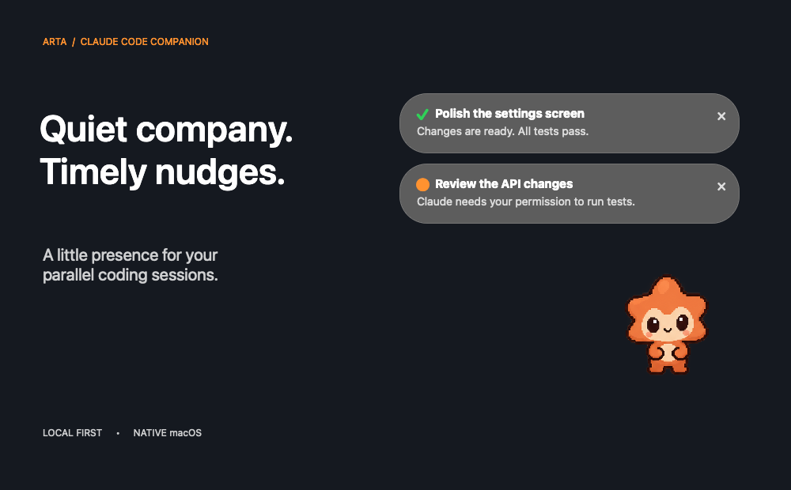
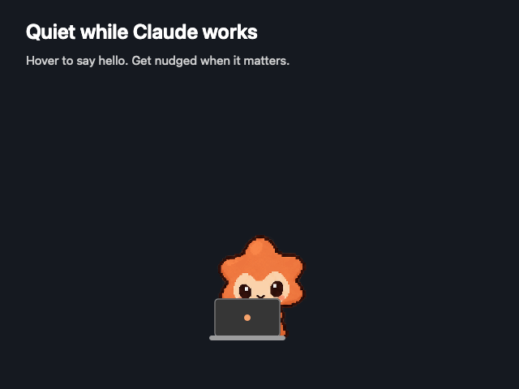
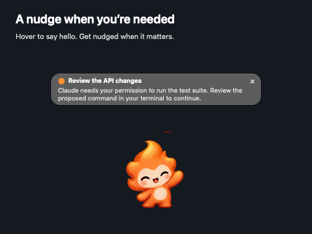
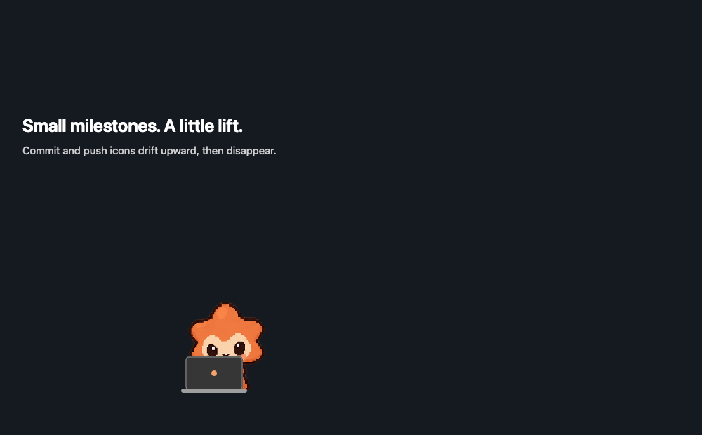
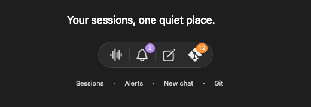

<div align="center">

# Arta

### Quiet company. Timely nudges.

An illustrated desktop companion for your Claude Code sessions.

[](https://github.com/bhanurp/arta/actions/workflows/ci.yml)




**Keep working. Arta will let you know when Claude needs you.**

[See it in action](#a-little-company-while-you-work) · [Get started](#get-started) · [Agent installation](#ask-your-agent-to-install-arta) · [Build from source](#build-from-source)

</div>

## A little company while you work

Arta floats above your other apps and keeps an eye on your local Claude Code sessions. It sits quietly at a laptop while work is happening, greets you when you hover, and animates briefly when a response finishes or needs your input.

<div align="center">

</div>

### The right nudge, at the right time

- **Today’s commits at a glance.** The compact hover bar shows a monochrome Git diamond with a badge for today’s successful commits from tracked sessions. The count survives restarts and resets at local midnight; pushes do not increment it.
- **A small menu-bar presence.** A static Arta pet icon replaces the long status text. Hover over it for working and waiting counts; click it for the menu.
- **One place for your sessions.** See which sessions are working or waiting for you.
- **Notifications that make room.** Two cards appear by default. Choose your own limit; dismiss one to bring the next queued message into view.
- **A subtle working signal.** A small green activity bar above the pet shows when Claude is working. It disappears on hover or while notification cards are visible; it indicates activity, not a completion percentage.
- **Quiet by default.** The button bar appears on hover. Completion and input requests can open the notification tray; routine activity stays out of the way.
- **No lost input requests.** Completion cards fade after ten visible seconds. Input requests remain until resolved or dismissed. Hidden cards do not time out.
- **A new chat, one button away.** Choose a project folder and start Claude Code in a new Terminal tab.

<details>
<summary>Take a closer look at an input notification</summary>



</details>

### Little celebrations for Git milestones

Successful commits release an orange icon; pushes release a teal arrow. They drift above the pet and fade over three seconds, without opening the notification tray.

<div align="center">

</div>

<sub>Documentation visuals are staged previews with sample data, rendered from Arta’s native AppKit views. The Git animation illustrates the effect; timing and available height vary on screen. No private sessions are shown.</sub>

## Get started

**Requires macOS 14 or later and an installed, signed-in copy of Claude Code.**

1. Download **Arta-v0.1.5-macos-arm64.zip** from the [latest release](https://github.com/bhanurp/arta/releases/latest) (Apple Silicon), or build from source below. Newer development builds are available as artifacts from successful [CI runs](https://github.com/bhanurp/arta/actions/workflows/ci.yml).
2. Extract the archive, open **Arta.app**, and click **Install & Start**.
3. Approve macOS Automation and Accessibility requests to enable new Terminal tabs. Permission setup can be retried from the menu bar.
4. Start a Claude Code session. Arta picks up its events automatically.

Installation copies Arta into `~/Applications`, installs the tracking helper, and backs up and merges Claude Code’s hook settings. Existing hooks and unrelated settings are preserved. **Disable tracking** removes only Arta’s hook entries.

> Development builds are ad-hoc signed, not notarized for public distribution. macOS may require approval to open a downloaded build. These are development artifacts, not a public release installer.

## Ask your agent to install Arta

Paste this into a coding agent that can run commands on your Mac:

```text
Install Arta from https://github.com/bhanurp/arta on this Mac.
Read the README's “Agent installation checklist” and follow the existing
installer. Check prerequisites and repository access, reuse an existing
checkout if available, build and verify the app, then open it and complete
Install & Start using UI tools if available. Preserve my Claude settings,
existing hooks, and Arta data. Help me approve the macOS permissions myself.
Verify a sample notification and a real Claude Code session event, then tell
me where the app is installed and which checks passed or still need me.
Do not create real Git commits or pushes just to test the visual effects.
```

### Agent installation checklist

1. **Check the Mac and access.** Require macOS 14 or later. Check `sw_vers`, `uname -m`, `xcodebuild -version`, `swift --version`, and `claude --version`. Source builds are verified with Xcode 26.2 / Swift 6.2.3. If Xcode or Claude Code is missing, explain the prerequisite before starting a large installation. Claude must be signed in; let the user complete sign-in without requesting or displaying credentials.
2. **Get the source.** This repository is public; cloning does not require a GitHub login. If using GitHub CLI, check `gh auth status` and `gh repo view bhanurp/arta`. Reuse an existing checkout after inspecting its changes; otherwise clone into a user-chosen development folder. Do not reset or overwrite local work.
3. **Build and verify.** Run the commands below from the repository root. Stop on a failed build or test and report the actual failure. A successful build creates `dist/Arta.app`; building alone does not install tracking.
4. **Use the app's installer.** Open `dist/Arta.app`, then click **Install & Start** in Sessions & settings. An agent with native UI tools can click it; without those tools, ask the user to perform this one step. There is currently no supported headless installation flag. The installer copies the app to `~/Applications/Arta.app`, installs the stable helper, backs up and merges hooks, and starts the installed copy. Do not manually replace the entire Claude settings file or add duplicate hooks.
5. **Let the user approve permissions.** The installed app requests Automation for Terminal/System Events and Accessibility for opening new Terminal tabs. The user must approve macOS privacy prompts. If declined, explain how to retry **Set up Terminal permissions…** from Arta's menu; do not change privacy databases or bypass macOS security controls. Development builds are not notarized, so opening a downloaded copy can also require user approval.
6. **Verify the result.** Confirm the app runs from `~/Applications/Arta.app`. Use **Sample notification** and verify that it appears automatically. Start or observe a real local Claude Code session and check that diagnostics report a received event. Existing sessions may need `/hooks` or a restart. Test **New Chat** after permission is granted; it should start Claude in the selected folder in a new Terminal tab. Distinguish successful installation from any unverified sign-in, permission, or session checks.

```bash
# From a new checkout, or an existing checkout whose local work is preserved:
swift format lint --strict --recursive Sources Tests Package.swift
swift test -Xswiftc -warnings-as-errors
scripts/build-app.sh
codesign --verify --deep --strict dist/Arta.app
open dist/Arta.app
# Finish with Install & Start in the app.
```

**Installation locations:** app at `~/Applications/Arta.app`; helper and state at `~/Library/Application Support/ClaudeCompanion/`; hooks in `~/.claude/settings.json`. If the user uses a custom `CLAUDE_CONFIG_DIR`, ensure Arta inherits that setting when launched and verify the intended settings file before enabling tracking. Keep existing state and configuration backups during upgrades. To undo tracking, use **Disable tracking** in Arta's menu.

## Make yourself at home



| Action | What happens |
| --- | --- |
| Drag the pet | Move Arta around your screen |
| Hover over the pet | Say hello and reveal the button bar |
| Click the pet or Sessions | Open sessions and settings |
| Click the bell | Show or hide notification cards |
| Click New Chat | Choose a folder and open a fresh Claude Code session |
| Click a notification | Go directly to the source session; no intermediate dialog |
| Change Visible messages | Set how many notification cards appear at once |
| Use the menu bar | Show/hide Arta, preview a notification, set up permissions, or disable tracking |

Hover and attention animations respect **macOS Reduce Motion**. Dismissing a notification never answers a question or grants Claude permission.

## Local by design

Arta does not upload conversations or require an API key. Tracking stays on your Mac. The helper records session metadata, selected response/request text, and source-app identifiers.

- Response previews are capped at 12,000 characters.
- Arta retains the newest 30 ordinary notifications, with seven-day cleanup. Unresolved input requests are exempt from both limits and stay until answered, the session ends, or you dismiss them. Opening an input bubble does not dismiss it.
- App data and the helper live in `~/Library/Application Support/ClaudeCompanion/`.
- Hook configuration lives in `~/.claude/settings.json`, or the `CLAUDE_CONFIG_DIR` inherited by Arta. Backups are stored alongside it.

The internal `ClaudeCompanion` identifiers remain for compatibility with earlier builds.

## What is supported today?

**Local Claude Code sessions.** Arta discovers running sessions from local metadata and observes new transcript records as a fallback. Sessions started before installation may need `/hooks` or a restart to load the hooks. Unknown status is shown when there is not enough evidence; old completions do not generate startup notifications.

Claude Desktop conversations, SSH, containers, and cloud sessions are not tracked yet. Disabled hooks, project-managed settings, and `claude --bare` may prevent delivery. Clicking a bubble goes directly to its source. Terminal and iTerm2 use the live Claude process’s terminal identity to select its tab/pane. Ghostty 1.3.x exposes project folders but not terminal-device identity: Arta selects a pane only if exactly one pane and one tracked session match that folder. Other hosts, ambiguous matches, and missing Automation permission fall back to activating the source app and leave an explanation in the bubble. Arta never guesses between same-folder Ghostty sessions. macOS may ask to allow Arta to control your terminal on the first click. No input is typed into the terminal. Finished or disconnected sessions cannot reliably reopen an original pane.

Transcript completion and question events remain a fallback even after hooks have been received, so a missed later hook does not permanently suppress notifications. Historical transcript contents are skipped at startup; tracking must be enabled and the pet visible for automatic popups.

Git effects recognize simple `git commit` and `git push` calls, including `git -C`/`-c` and successful `cd`/`git add` chains joined with `&&`. Scripts, aliases, complex shell expressions, dry runs, failed calls, and interrupted calls are skipped.

## Build from source

Use **Xcode 26.2 / Swift 6.2.3** to match CI. There are no third-party runtime dependencies.

```bash
git clone https://github.com/bhanurp/arta.git
cd arta
swift test -Xswiftc -warnings-as-errors
scripts/build-app.sh
open dist/Arta.app
```

### Code quality and CI

Every push and pull request runs macOS GitHub Actions checks for:

- Strict Swift formatting and lint.
- Compilation with warnings treated as errors.
- Tests with coverage.
- Shell syntax and property-list validation.
- Release app packaging and code-signature verification.

Run the style check locally:

```bash
swift format lint --strict --recursive Sources Tests Package.swift
```

Regenerate the staged README visuals on macOS:

```bash
scripts/render-readme-media.sh
```

See [VERIFICATION.md](VERIFICATION.md) for verification history and known limits.

## Avatar-ready artwork

The menu bar uses a dedicated vector face icon for crisp Retina rendering. Avatar artwork is separate from session tracking: sprite layout, animation timing, rendering style, and menu icon are configured in a manifest. See [Creating avatars](docs/AVATARS.md) for the asset contract. The current build bundles one avatar; an in-app avatar picker is not included yet.

The desktop character uses original smoothly shaded illustration with four pose sets, including its own laptop working pose. See [artwork notes and generation prompts](docs/ARTWORK.md).

## Automatic updates

Arta uses [Sparkle](https://sparkle-project.org/) to check for stable releases every four hours while running. Updates are downloaded automatically and verified with Arta’s Ed25519 signing key before extraction. Sparkle handles installation and relaunch; it may offer an Install and Relaunch prompt. Claude Code runs separately and is not terminated by an Arta update.

Use **Check for Updates…** in the menu bar for an immediate check, or turn off **Automatically update Arta**. Preferences and session history remain outside the app bundle, and the tracking helper refreshes on launch. v0.1.0 has no updater: install an updater-enabled build manually once.

### Publishing an update

1. Commit the intended source and update its version in `Resources/Info.plist`.
2. Run **Actions → Publish signed update → Run workflow**, selecting the source branch and entering an unused stable tag such as `v0.1.2` (each version component below 1000). The workflow runs tests, builds the Apple Silicon app, and signs the archive.
3. The workflow creates a draft release at the tested commit, uploads its archive, publishes it, then updates `updates/appcast.xml` on `main`. GitHub locks published assets, so do not publish the release manually before upload. Older versions cannot replace a newer feed entry.

The workflow requires the repository Actions secret `SPARKLE_PRIVATE_KEY`. The matching private key is kept in the maintainer’s macOS Keychain under Sparkle account `arta`; the public key is in `Resources/Info.plist`. Never commit the private key. Keep a secure backup: losing it prevents updates to existing installs. Changes to the archive invalidate its signature, so do not replace published assets. If upload succeeded but feed publication failed, rerun only the feed publication step with the original signed appcast; do not overwrite the archive.

Use v0.1.3 or newer for automatic updates. The v0.1.1 release has no download; v0.1.2 was withdrawn from the feed because of a resource packaging crash. Archive signing is separate from Apple Developer ID signing: these builds remain ad-hoc signed and unnotarized.

### Choose your app icon

Open **Sessions & settings → App icon** to choose Ember, Byte, or Kitsu. You can also use **Appearance → App Icon** in the menu bar. The selection applies immediately and is remembered after restart. These static icons change the menu-bar and running application icon; the animated desktop avatar is independent.
